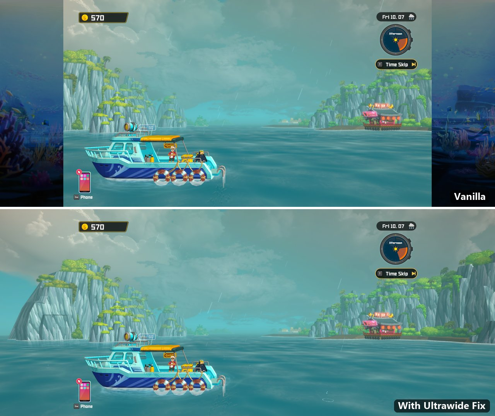
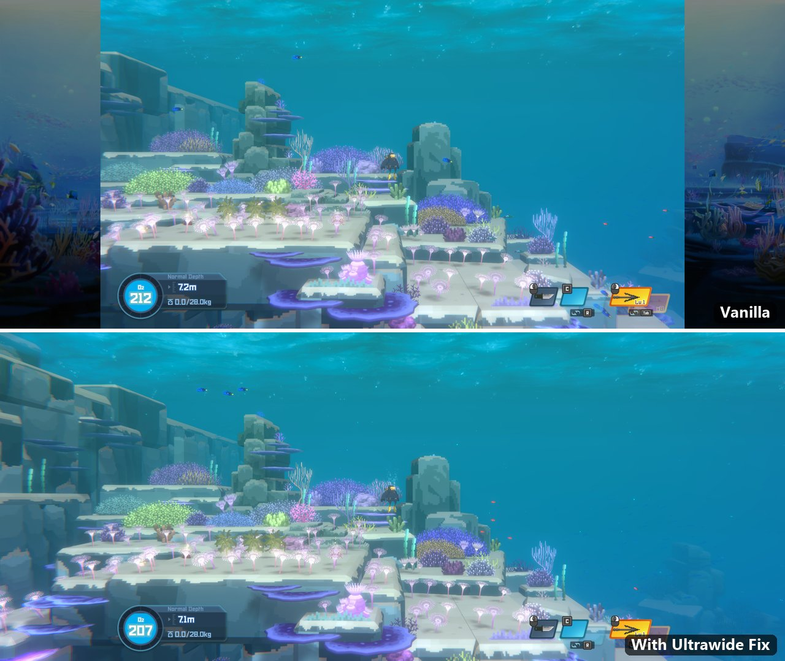
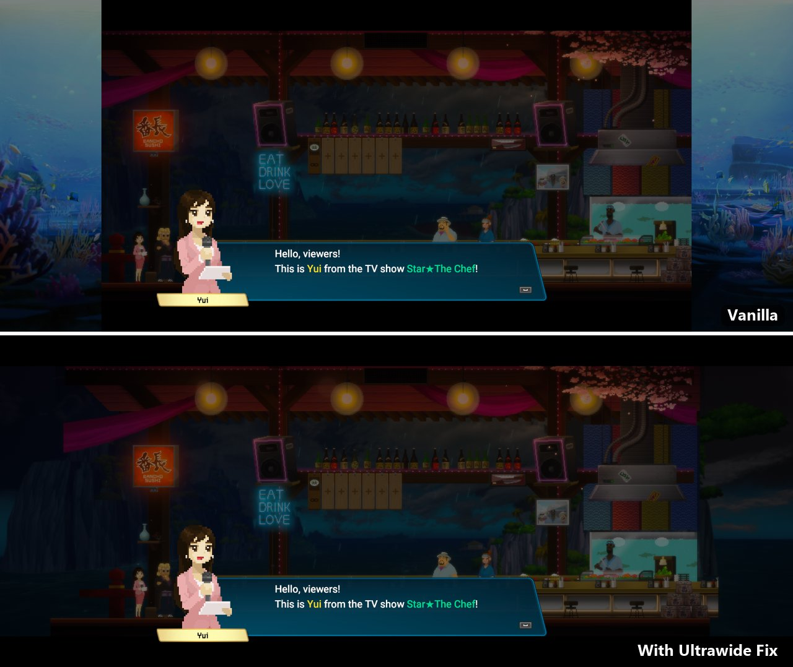
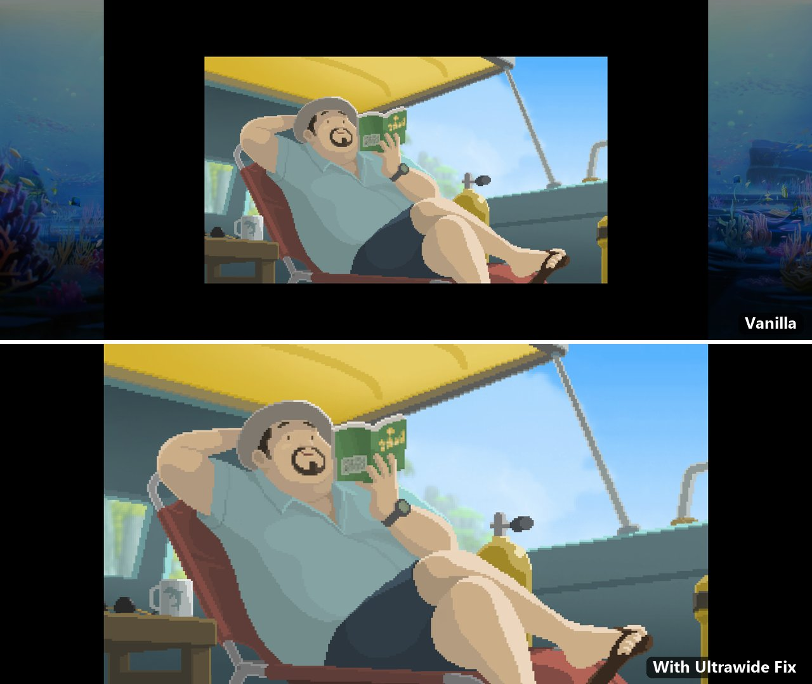
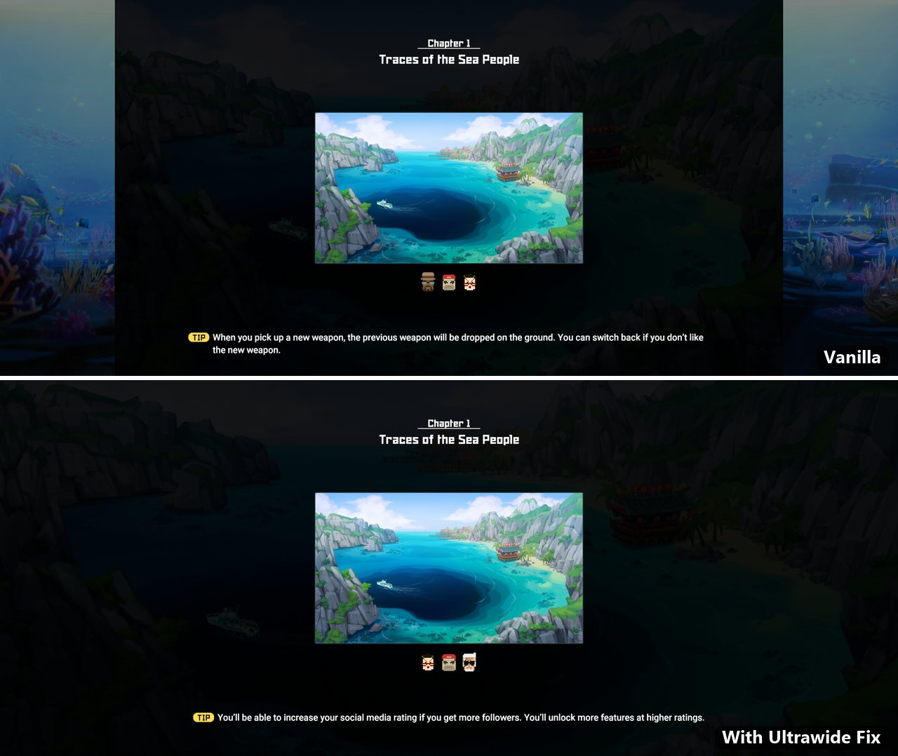
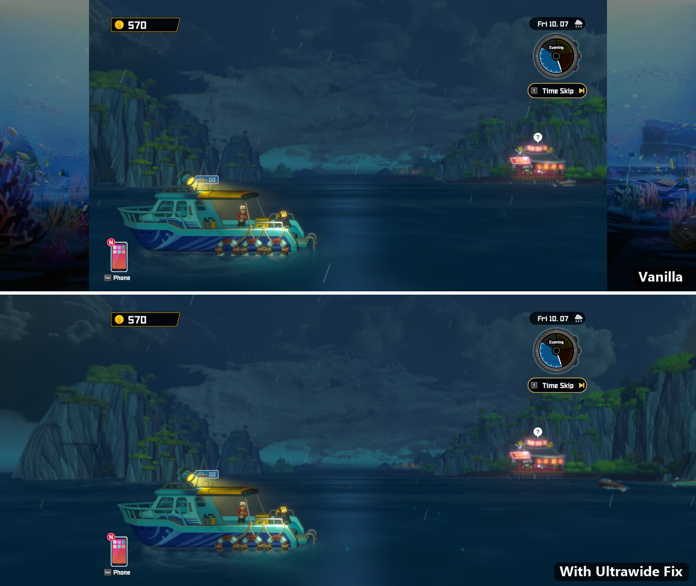
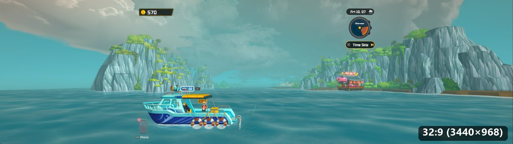
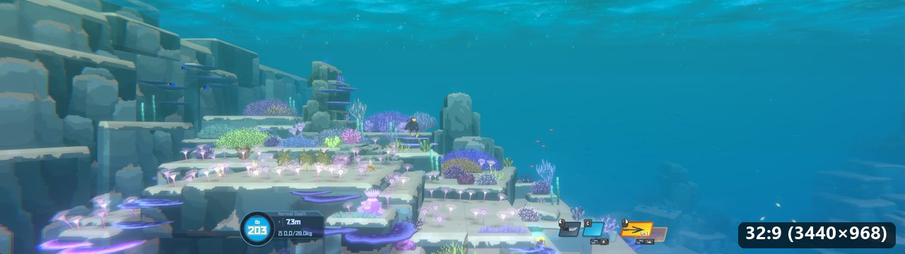

# Dave the Diver – Ultrawide Fix

A [BepInEx](https://github.com/BepInEx/BepInEx) plugin that lets Dave the Diver use the full width of ultrawide monitors (21:9, 32:9, …) instead of showing pillarbox art at the sides.

- The game world (diving, boat, sushi bar, cutscenes, title screen) fills the whole screen.
- HUD and menus stay in a centered 16:9 area, the way the game was designed.
- Screen fades, dimmed popup backgrounds, cutscene bars and vignettes are extended to the full width.
- The small pixel-art scenes (e.g. after a Time Skip) are shown as large as the screen height allows, and loading-screen backgrounds fill the width.
- UI that follows things in the world (sushi bar order bubbles, speech bubbles, damage numbers, QTE markers) stays lined up with its target instead of drifting toward the center.
- Story characters' boats that wait just outside the 16:9 view on the boat scene stay hidden until they sail in.
- At 16:9 or narrower the game behaves exactly as without the fix.

Tested with the Steam version v1.0.6.2113 at 3440×1440 (21:9), and at 32:9 in a 3440×968 window.

## Screenshots

All taken at 3440×1440 (scaled down), vanilla on top, with the fix below.

<b>Diving</b>: the reef fills the screen, the HUD stays where it was

<b>Cutscenes</b>: the scene and the cutscene bars span the full width

<b>Time Skip</b>: the pixel-art scene at full screen height instead of 2/3 size

<b>Loading screen</b>: the background picture covers the width

<b>Evening on the boat</b>

<b>32:9</b>

## Install

1. Download `DaveTheDiver-UltrawideFix-vX.Y.Z.zip` from the [Releases](../../releases) page.
2. In Steam, right-click Dave the Diver → **Manage → Browse local files**.
3. Extract **everything** from the zip into that folder (next to `DaveTheDiver.exe`).
4. Start the game. **The first launch takes 1–3 minutes** before the window appears; later launches are normal.
5. In the game: **Settings → Graphics**, pick your monitor's resolution and *Full Window Mode* or *Fullscreen*.

Steam Deck / Linux (Proton): add `WINEDLLOVERRIDES="winhttp=n,b" %command%` to the launch options.

## Uninstall

Delete `BepInEx/`, `dotnet/`, `winhttp.dll`, `doorstop_config.ini` and `.doorstop_version` from the game folder.

## Configuration

After the first launch, edit `BepInEx/config/dtd.ultrawide.cfg`:

| Setting | Default | Description |
|---|---|---|
| `Enabled` | `true` | Turn the whole fix on/off. |
| `WidenOverlays` | `true` | Extend fades and popup backgrounds to the full width. |
| `ClipUIToCenter` | `true` | Hide UI the game keeps just outside the 16:9 area (e.g. slide-in tabs). |
| `FixWorldUI` | `true` | Keep world-following UI (order bubbles, speech bubbles, damage numbers) on its target. |
| `ScaleCutscenes` | `true` | Show the small pixel-art scenes (e.g. after a Time Skip) at full screen height instead of 2/3 size. |
| `CoverImages` | `Title,DummySushiBar` | Full-screen background images that are zoomed to fill the width. |
| `VerboseLogging` | `false` | Log every change the fix makes to `BepInEx/LogOutput.log`. |

## How it works

- **Camera:** the game's `CameraResolution` computes a centered 16:9 viewport for wider screens and applies it to every camera. The plugin replaces that viewport with the full screen and hides the black side masks.
- **UI:** every UI canvas puts its content in a panel with a 16:9 `AspectRatioFitter`, so the HUD stays centered by itself. When a solid-color, full-width image inside such a panel is enabled (hooked through `Image.OnEnable`), the plugin adds two side strips that extend it to the screen edges and mirror its color, alpha and visibility. Vignettes are stretched, the listed background images and overlays that switch to a picture at runtime (loading backgrounds) are scaled up to cover the width, and a `RectMask2D` on each panel keeps parked off-screen UI hidden.
- **Pixel-art scenes:** these are a 320×180 masked image shown at 4× inside a 1920×1080 container, so they fill only 2/3 of the 16:9 area by design. The plugin scales the container so the image fills the screen height (exactly 8× at 1440p).
- **Sushi bar scenery:** a ground mesh of the lobby environment behind the sushi bar is fully covered by the building at 16:9, but its far end shows as a flat brown slab right of the kitchen on wider screens. The plugin hides it there, leaving open sea.
- **Boat scene clouds:** the sky is made of flat cloud cards. One cloud texture is opaque up to its border, so its card ends in a straight cut just outside the 16:9 view, which shows as a hard vertical edge in the sky at 32:9. When that end is on screen in a side area, the plugin stretches the card along its length (the other end stays put) until the end is off screen. At 21:9 the end is already off screen and nothing changes.
- **NPC boats:** the boats of story characters (Bacon, Sato, Clara, …) wait under `NPCBoatDock` at parking spots just outside the 16:9 view, so on wider screens they peek in at the edges. The plugin turns off their renderers and lights while they are parked and turns them back on when the game calls a boat in (`LobbyNPCBoatDockCtrl.EnterNPCBoat` / `AppearedNPCBoat`) until it has left again (`OnExitFinished`), or as soon as it moves away from its parking spot.
- **World-following UI:** the game positions bubbles and markers with `Camera.WorldToViewportPoint` and puts the result in the anchors of an element inside the 16:9 panel. With the widened camera, 0–1 covers the whole screen instead of the panel, so everything drifts toward the center (the misaligned sushi bar bubbles known from other ultrawide workarounds). The plugin remaps the x of that call for the widened cameras so 0–1 means the 16:9 area again, and exempts these elements from the panel clipping so they also show in the side areas. The remap only applies while one of the game's anchor-positioning methods runs (hooked with Harmony; the list comes from all callers of `WorldToViewportPoint`, sorted by what they do with the result). UI that maps the point onto the full-width canvas itself (e.g. the NPC emojis on the boat), image effects (sun shafts, depth of field, vignettes) and visibility checks get the real viewport point.

The game's own layout is never modified for the HUD, so menus and navigation behave as on a 16:9 screen.

## Building

See [BUILDING.md](BUILDING.md).

## License

The plugin source is released under the [MIT License](LICENSE). The release zip bundles [BepInEx 6](https://github.com/BepInEx/BepInEx), which is licensed under LGPL-2.1.

Not affiliated with MINTROCKET or NEXON.
